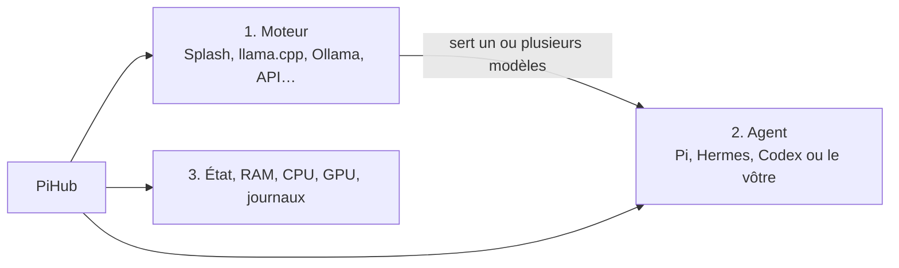

<p align="center">
  
</p>

# PiHub

### Lancez vos moteurs locaux, choisissez leurs modèles et reliez-les à vos agents — depuis la barre des menus macOS.

PiHub est un centre de contrôle local pour une machine IA personnelle. Il ne remplace ni Splash, ni llama.cpp, ni Ollama, ni vos agents : il les organise. Vous voyez ce qui tourne, quel modèle est réellement servi, quel agent dépend de quel moteur, et vous gardez vos réglages dans des fichiers locaux lisibles.

[Installer PiHub](docs/INSTALLATION.md) · [Faire son premier parcours](docs/USAGE.md) · [Voir tous les guides](docs/README.md) · [Créer ou importer une intégration](docs/EXTENSIONS.md)

> Dans l’interface et le manuel, un **moteur** est ce qui sert un modèle à des agents : Splash, llama.cpp, MLX LM, Ollama ou une API compatible. Le code et les manifests gardent le mot technique `provider` pour préserver leur contrat public.

## En 30 secondes



1. Dans **Explorer**, installez ou connectez un moteur.
2. Dans **Moteurs**, choisissez son modèle, son port et ses options, puis cliquez sur **Démarrer**.
3. Dans **Agents**, choisissez ce moteur dans **Routage**, puis ouvrez le terminal ou le dashboard proposé.

Le résumé montre ensuite l’arbre `moteur → agents`, les modèles servis et les branches arrêtées en grisé. Quand vous changez de modèle, PiHub peut relancer le moteur, attendre qu’il soit prêt, puis appeler le handler propre à chaque agent sélectionné.

## Ce que vous pouvez faire, concrètement

| Vous voulez… | Dans PiHub |
| --- | --- |
| Utiliser Splash, llama.cpp, MLX LM ou Ollama | Ouvrez **Explorer**, lisez la fiche, puis installez ou configurez le runtime déjà présent. |
| Connecter LM Studio, vLLM ou un serveur distant | Ajoutez **API compatible**, renseignez l’URL `/v1`, le modèle et éventuellement le nom de variable de clé. |
| Lancer Pi, Hermes ou Codex sur votre moteur local | Ajoutez l’agent, choisissez le moteur dans **Routage**, puis cliquez sur son action de lancement. |
| Savoir pourquoi un port reste pris | Ouvrez **Activité** ou **Journal** : PiHub suit ses groupes de processus et attend la libération du port à l’arrêt. |
| Ajouter votre propre outil | Importez un dossier contenant `manifest.json` et, si nécessaire, des handlers Python. |
| Partager une intégration | Exportez son dossier ; les exécutables, modèles, clés et sessions restent hors du paquet. |

## Votre premier succès

### J’ai déjà un serveur local ou distant

1. Cliquez sur l’icône PiHub dans la barre des menus, puis sur **Agrandir**.
2. Ouvrez **Explorer → API compatible → Ajouter une instance**.
3. Cliquez sur le curseur de l’instance, puis renseignez **URL de base API**, par exemple `http://127.0.0.1:18000/v1`, et **Modèle**.
4. Cliquez sur **Enregistrer**, puis **Diagnostic → Tester API**.
5. Ouvrez **Agents → +**, ajoutez Pi, Hermes ou Codex, puis choisissez votre moteur dans **Routage**.

### Je pars de zéro avec un modèle local

1. Ouvrez **Explorer** et choisissez le runtime qui correspond à vos poids : MLX pour un dépôt MLX, llama.cpp pour un fichier GGUF, Ollama pour une bibliothèque Ollama.
2. Cliquez sur la fiche, lisez les prérequis puis sur **Installer**. PiHub montre le journal du job et ne lance pas le runtime à votre place.
3. Ouvrez l’instance créée dans **Moteurs**. Dans **Modèle**, choisissez une référence ou saisissez votre chemin/identifiant.
4. Cliquez sur **Démarrer**. Attendez **Prêt** et vérifiez le modèle sous `Sert · …` dans le résumé.
5. Ajoutez un agent et reliez-le à ce moteur.

[Guide illustré, clic par clic →](docs/USAGE.md)

## Ce que PiHub ne fait pas

- Il ne télécharge pas tous les modèles ni ne convertit universellement leurs poids.
- Il ne tue pas des processus externes par nom : un processus doit être lancé ou explicitement pris en charge par PiHub.
- Il ne promet pas qu’un moteur compatible OpenAI suffit pour tous les agents : Codex, notamment, attend l’API Responses et les appels d’outils.
- Il ne stocke pas vos clés dans un manifeste. Référencez une variable d’environnement.

## Inclus aujourd’hui

| Catégorie | Intégrations livrées |
| --- | --- |
| Moteurs | Splash, llama.cpp, MLX LM, Ollama, API compatible OpenAI. |
| Agents | Pi Agent, Hermes (terminal + dashboard), Codex. |
| Extension | Dossiers importables, manifests versionnés, handlers optionnels et recettes d’installation. |

Une intégration livrée est une **définition**, pas une installation implicite. Un workspace neuf n’a ni runtime, ni modèle, ni agent actif : vous n’ajoutez que ce que vous souhaitez utiliser.

## Installer PiHub

Sur un Mac Apple Silicon, ouvrez Terminal puis exécutez exactement :

```sh
xcode-select --install
cd /chemin/vers/PiHub
make check
make manager
```

Une fois l’installation Apple terminée, `make manager` construit puis ouvre `PiHubManager.app`. Cliquez sur l’icône dans la barre des menus. Le guide [Installation](docs/INSTALLATION.md) détaille chaque étape, la mise à jour et le dépannage de compilation.

## Ajouter ou développer une intégration

Une intégration est un dossier transportable :

```text
mon-moteur-ou-agent/
├── manifest.json      # identité, formulaire, capacités et recette optionnelle
├── handler.py         # comportement spécifique, si nécessaire
└── …                  # modules ou ressources locales
```

Depuis l’application : **Explorer → Importer un dossier** → sélectionnez le dossier → lisez la validation → **Importer et configurer**.

Les guides [Importer et partager](docs/IMPORT_EXPORT.md), [Créer une intégration](docs/EXTENSIONS.md) et la [référence du manifeste](docs/MANIFEST_REFERENCE.md) expliquent le parcours avec un exemple fonctionnel.

## Documentation

| Je veux… | Guide |
| --- | --- |
| Installer, ouvrir ou mettre à jour l’app | [Installation](docs/INSTALLATION.md) |
| Ajouter un moteur, un agent ou une API | [Utilisation](docs/USAGE.md) |
| Comprendre formats, chemins et rattachements de modèles | [Modèles](docs/MODELS.md) |
| Installer/mettre à jour un runtime depuis Explorer | [Catalogue](docs/CATALOG.md) |
| Importer, exporter ou sauvegarder | [Import / export](docs/IMPORT_EXPORT.md) |
| Développer une intégration communautaire | [Extensions](docs/EXTENSIONS.md) |
| Consulter le contrat JSON/handlers | [Référence du manifeste](docs/MANIFEST_REFERENCE.md) |
| Déboguer une installation ou un port | [Dépannage](docs/TROUBLESHOOTING.md) |

## Pour contribuer

Le cœur est volontairement petit : SwiftUI pour la surface macOS, Python standard pour les opérations et un manifeste/handlers par intégration. Lancez `make test` avant une contribution ; consultez [CONTRIBUTING.md](CONTRIBUTING.md) et [Développement](docs/DEVELOPMENT.md) pour l’arborescence et les tests.
