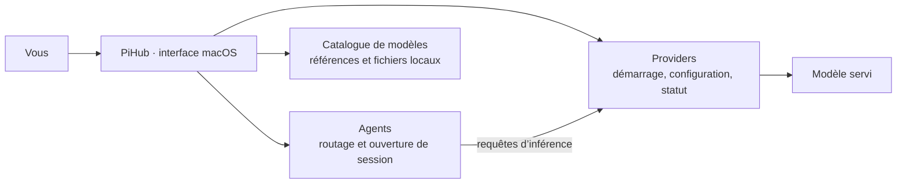

# PiHub

### Vos providers, modèles et agents IA dans la barre des menus de macOS.

PiHub est une application native SwiftUI pour piloter un environnement IA local : démarrer des moteurs d’inférence, connecter des API, choisir des modèles, ouvrir des agents dans Terminal et suivre les processus depuis une seule interface.

Son principe d’extension est simple : **un provider ou un agent = un dossier avec un `manifest.json` et ses handlers Python**. Le même JSON décrit les réglages, les actions et l’installation optionnelle du runtime.

[Installer](docs/INSTALLATION.md) · [Premier lancement](docs/USAGE.md) · [Modèles](docs/MODELS.md) · [Importer une intégration](docs/IMPORT_EXPORT.md) · [Créer son intégration](docs/EXTENSIONS.md) · [Toute la documentation](docs/README.md)

---

## Sommaire

- [Ce que fait PiHub](#ce-que-fait-pihub)
- [Comprendre les quatre objets](#comprendre-les-quatre-objets)
- [Installation rapide](#installation-rapide)
- [Votre premier parcours](#votre-premier-parcours)
- [Intégrations incluses](#intégrations-incluses)
- [Ajouter et partager ses intégrations](#ajouter-et-partager-ses-intégrations)
- [Organisation du projet](#organisation-du-projet)
- [Documentation par chapitre](#documentation-par-chapitre)
- [Développement et publication](#développement-et-publication)
- [État et limites](#état-et-limites)

## Ce que fait PiHub

- Gérer plusieurs providers et plusieurs instances d’une même intégration, avec des ports et des réglages indépendants.
- Réutiliser un runtime déjà installé, installer un runtime depuis l’Explorateur ou connecter un endpoint distant.
- Centraliser les références de modèles MLX, GGUF, Ollama et API.
- Relier un agent à un provider, choisir son modèle et son niveau de réflexion.
- Ouvrir une session terminal, et un dashboard Web quand l’intégration le propose.
- Afficher les ressources observées, les statuts, les journaux et les relations entre modèles, providers et agents.
- Ajouter des intégrations personnelles en important un dossier, sans modifier le cœur de PiHub.

Deux présentations sont disponibles : un panneau compact depuis la barre des menus et une fenêtre détachable. Les providers, agents, modèles, l’Explorateur, l’activité et les réglages restent accessibles dans les deux modes.



PiHub pilote les programmes. Les requêtes d’inférence de l’agent vont à son provider ; PiHub n’est pas un proxy central de toutes les conversations.

## Comprendre les quatre objets

| Objet | Ce qu’il représente | Exemple |
| --- | --- | --- |
| **Intégration** | La définition réutilisable d’un programme : formulaire, commandes, handlers et recette d’installation. | Le dossier `integrations/pi/`. |
| **Instance** | Une configuration concrète de cette intégration dans votre workspace. | « Pi — projet mobile », relié à « Splash — local ». |
| **Runtime** | Le logiciel réellement exécuté sur votre machine. | Un exécutable Pi ou un serveur llama.cpp. |
| **Modèle** | Une référence ou des poids que le provider sait charger. | Un fichier `.gguf`, un dépôt MLX ou un identifiant d’API. |

**Importer une intégration ne télécharge pas son runtime. Installer un runtime ne télécharge pas automatiquement les poids d’un modèle.** Le premier workspace est vide : vous choisissez ce que vous voulez utiliser.

## Installation rapide

Prérequis du manager :

- macOS 13 ou supérieur sur Apple Silicon ;
- les outils de développement Apple ;
- `/usr/bin/python3` en version 3.9 ou supérieure, disponible avec l’environnement de développement Apple.

Téléchargez le dépôt depuis GitHub, décompressez-le puis ouvrez un terminal à sa racine. Si vous utilisez Git, clonez l’URL du dépôt dans lequel vous lisez cette documentation.

```sh
xcode-select --install
cd /chemin/vers/PiHub
make check
make manager
```

Attendez la fin de l’installation des outils Apple avant de lancer `make check`. `make manager` construit `PiHubManager.app` puis l’ouvre en arrière-plan. Cliquez sur son icône dans la barre des menus.

Pour ouvrir directement la fenêtre :

```sh
open PiHubManager.app --args --window
```

Pour partager une copie compilable, **`Makefile` et le dossier complet `pihub-manager/` doivent rester côte à côte**. La construction du manager ne nécessite aucun moteur ni modèle préinstallé.

Les runtimes ont leurs propres prérequis : Node/npm, uv, CMake, version de macOS, etc. L’Explorateur affiche ceux de chaque intégration. La distribution Splash référencée actuellement nécessite macOS 26 ou supérieur.

[Installation détaillée, mise à jour et commandes Make →](docs/INSTALLATION.md)

## Votre premier parcours

### Vous possédez déjà un serveur ou une API

1. Ouvrez **Explorateur → API compatible → Ajouter une instance**.
2. Dans ses réglages, renseignez l’URL de base, par exemple `http://127.0.0.1:18000/v1`, et le modèle.
3. Si nécessaire, renseignez le **nom de la variable d’environnement** contenant la clé.
4. Enregistrez puis utilisez **Diagnostic → Tester API**.
5. Ajoutez un agent, choisissez ce provider dans **Routage**, puis ouvrez son terminal.

Le protocole de votre API doit correspondre à celui attendu par l’agent. Une API Chat Completions ne suffit pas à tous les agents.

### Vous partez de zéro en local

1. Ouvrez **Explorateur** et choisissez un moteur adapté au format de votre modèle.
2. Consultez sa source, sa version et ses prérequis, puis choisissez **Installer…**.
3. Configurez l’instance créée : modèle, port, mémoire, contexte et options utiles.
4. Démarrez le provider et attendez qu’il soit prêt.
5. Ajoutez un agent, sélectionnez le provider et ouvrez sa session.

### Vous voulez comprendre avant d’installer un vrai moteur

Les [exemples importables](docs/examples/README.md) proposent un provider HTTP et un agent terminal sans dépendance supplémentaire. Ils utilisent un service d’écho pédagogique, **sans modèle IA et sans téléchargement de poids**.

[Parcours complet et utilisation quotidienne →](docs/USAGE.md)

## Intégrations incluses

| Type | Intégration | Usage et points à connaître |
| --- | --- | --- |
| Provider | Splash | Inférence MLX/Metal, paramètres de mémoire/cache et options propres à Splash. |
| Provider | llama.cpp | Modèles GGUF, accélération Metal et réglages du serveur. |
| Provider | MLX LM | Modèles MLX/safetensors et options du serveur MLX LM. |
| Provider | Ollama | Connexion au daemon et actions de chargement/libération de modèles. |
| Provider | API compatible | Connexion à un endpoint existant, avec clé via une variable d’environnement. |
| Agent | Pi Agent | Session terminal, modèle routé, réflexion et sélection d’outils. |
| Agent | Hermes | Profil dédié par instance, terminal, dashboard et configuration du gateway. |
| Agent | Codex | Configuration native ou provider personnalisé compatible Responses et outils. |

La présence d’une intégration indique que PiHub possède sa définition. Elle ne garantit ni la présence de son runtime, ni la compatibilité de tous les modèles avec ce programme.

Les versions et commits de référence sont dans le bloc `install` de chaque [manifeste inclus](pihub-manager/integrations/). Le niveau de vérification de la recette est visible dans l’Explorateur.

[Installation des runtimes et versions de référence →](docs/CATALOG.md)

## Ajouter et partager ses intégrations

```text
mon-provider/
├── manifest.json       # identité, formulaire, actions, installation optionnelle
├── handler.py          # fonctions Python référencées par le manifeste
└── ...                 # modules et ressources optionnels
```

Dans PiHub :

1. **Explorateur → Importer une intégration → Dossier…**.
2. Sélectionnez le dossier contenant `manifest.json`.
3. Vérifiez la définition puis choisissez **Importer seulement** ou **Importer et configurer**.
4. Retrouvez l’intégration dans l’Explorateur.
5. Pour la partager, ouvrez sa fiche et choisissez **Exporter le dossier**.

Vous pouvez aussi déposer le dossier dans `.pihub/integrations/<id>/`. Il est découvert au prochain rafraîchissement.

Une intégration personnelle ayant le même `id` qu’une intégration livrée la remplace pour ce workspace. Pour créer une variante indépendante, choisissez un nouvel `id`.

Les handlers Python sont du code local exécuté par PiHub. Importez du code dont vous connaissez la provenance et gardez les clés, sessions et poids hors des dossiers partagés.

[Import/export et sauvegardes →](docs/IMPORT_EXPORT.md)  
[Créer un provider ou un agent →](docs/EXTENSIONS.md)  
[Référence de tous les champs du manifeste →](docs/MANIFEST_REFERENCE.md)

## Organisation du projet

```text
PiHub/
├── Makefile
├── README.md
├── CONTRIBUTING.md
├── docs/                           # chapitres, schémas et exemples importables
├── .github/                        # CI et modèles de contributions
├── pihub-manager/
│   ├── build-swift.sh
│   ├── swift/                      # application native
│   ├── src/pihub_manager/hub/       # backend Python et helpers communs
│   ├── integrations/<id>/
│   │   ├── manifest.json
│   │   └── handler.py
│   ├── templates/Info.plist
│   └── tests/
├── PiHubManager.app/                # généré à la compilation
└── .pihub/                          # données privées créées à l’utilisation
```

Les paramètres des instances se trouvent dans `.pihub/config.json`. Les intégrations personnelles sont dans `.pihub/integrations/`, les runtimes installés dans `.pihub/packages/`, les logs dans `.pihub/logs/`.

Ces données locales sont distinctes du code à publier. D’anciens environnements peuvent aussi utiliser `engine/`, `env/`, `hermes/`, `hermes-agent/`, `pi-agent/`, `models/` ou `profile/` : ils ne sont pas requis pour construire le manager.

[Arborescence complète et fonctionnement interne →](docs/ARCHITECTURE.md)

## Documentation par chapitre

| Chapitre | Pour répondre à quelle question ? |
| --- | --- |
| [01 · Installation](docs/INSTALLATION.md) | Comment construire, ouvrir et mettre à jour PiHub ? |
| [02 · Utilisation](docs/USAGE.md) | Comment configurer providers, agents et sessions ? |
| [03 · Modèles](docs/MODELS.md) | Comment ajouter un GGUF, un dépôt MLX ou un modèle distant ? |
| [04 · Importer, exporter, sauvegarder](docs/IMPORT_EXPORT.md) | Qu’est-ce qui se partage et où sont mes données ? |
| [05 · Créer une intégration](docs/EXTENSIONS.md) | Comment ajouter mon propre provider ou agent ? |
| [06 · Référence du manifeste](docs/MANIFEST_REFERENCE.md) | Quels champs, hooks, types de paramètres et variables sont disponibles ? |
| [07 · Installer les runtimes](docs/CATALOG.md) | Comment écrire une recette, choisir un commit et diagnostiquer une installation ? |
| [08 · Architecture](docs/ARCHITECTURE.md) | Comment l’interface, le backend et les processus communiquent-ils ? |
| [09 · Développer et contribuer](docs/DEVELOPMENT.md) | Où modifier le code, tester et préparer une publication ? |
| [10 · Dépannage](docs/TROUBLESHOOTING.md) | Où chercher lorsqu’une commande, un modèle ou un agent échoue ? |

## Développement et publication

```sh
make help
make test
make manager-build
make manager-reload
make package-source
```

`make package-source` produit `.pihub/exports/PiHub-source.tar.gz` à partir d’une liste explicite de sources. L’archive inclut cette documentation et les exemples ; elle exclut les runtimes installés, les modèles, les sessions et les sauvegardes privées.

Pour créer un dépôt GitHub depuis une installation locale déjà utilisée, partez de cette archive. [Le guide de publication](docs/DEVELOPMENT.md) explique quoi envoyer et les points encore à renseigner, notamment la licence du projet.

## État et limites

- L’interface cible macOS et Apple Silicon. Elle est construite depuis les sources et signée localement ; ce dépôt ne fournit pas une distribution universelle notarialisée.
- Le backend utilise la bibliothèque standard Python. Les programmes tiers conservent leurs dépendances, licences et contraintes.
- Le catalogue référence des modèles ; il n’est pas un gestionnaire universel de téléchargement ou de conversion des poids.
- Changer un modèle enregistré ne remplace pas immédiatement celui d’un processus actif. PiHub propose les opérations disponibles et demande confirmation avant les relances proposées.
- La RAM et le CPU viennent des processus observés. Le GPU système est affiché lorsqu’il est disponible ; PiHub n’invente pas une consommation GPU par agent.
- Le contrôle de processus est fondé sur les processus suivis par PiHub. Les programmes externes ne deviennent pas automatiquement des processus gérés.
- Les tests couvrent le manager et des runtimes de test locaux. Ils ne certifient pas une installation neuve de chaque logiciel tiers sur tous les Mac.

[Ouvrir le manuel complet →](docs/README.md)
