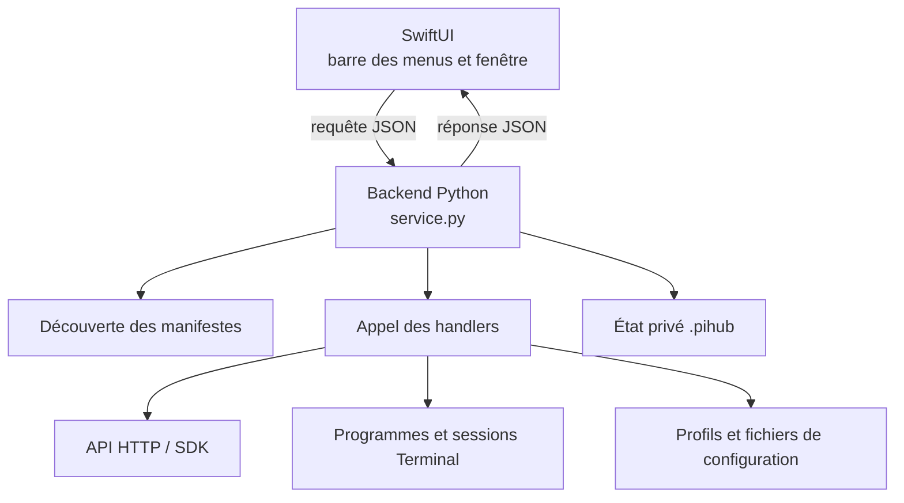
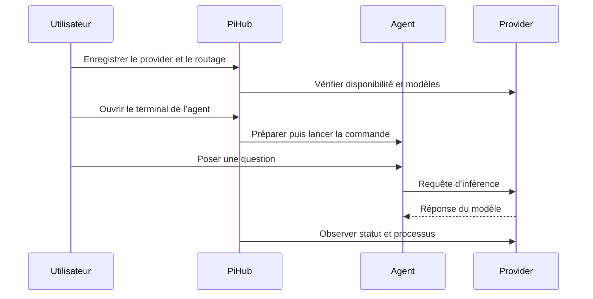

# 08 · Architecture et stockage

[Manuel](README.md) · [Précédent : installation des runtimes](CATALOG.md) · [Suivant : développement](DEVELOPMENT.md)

## Les couches du manager

PiHub associe une interface SwiftUI native, un backend Python et des dossiers d’intégration.



Le manager ne lance pas un serveur Web de gestion permanent. L’interface appelle `/usr/bin/python3 -m pihub_manager.hub` et échange une requête/réponse JSON avec le backend.

Les programmes d’inférence et d’agent sont des processus séparés. Leurs requêtes de génération n’empruntent pas toutes ce transport de gestion.

## Contrôle et données d’inférence



PiHub ne déduit donc pas une comptabilité universelle des tokens ou des coûts de toutes les conversations.

## Découverte et priorité

Le backend lit, dans cet ordre :

1. `pihub-manager/integrations/*/manifest.json` ;
2. `.pihub/integrations/*/manifest.json`.

Une définition personnelle portant le même ID remplace la version livrée. L’Explorateur projette le même manifeste en entrée de catalogue ; sa recette vient de `install`.

La présence de fonctions valides dans `handlers` détermine les capacités. Les hooks internes servent au contrôle ; les autres peuvent devenir des actions publiques.

Les fichiers Python sont résolus par rapport au manifeste. Le chargeur peut traiter le handler comme un package pour ses imports relatifs de modules voisins.

## Où sont les fichiers

```text
PiHub/
├── Makefile
├── README.md
├── CONTRIBUTING.md
├── docs/
│   ├── README.md
│   ├── ...chapitres...
│   └── examples/
├── .github/
├── pihub-manager/
│   ├── build-swift.sh
│   ├── swift/
│   ├── src/pihub_manager/hub/
│   ├── integrations/<id>/
│   │   ├── manifest.json
│   │   └── handler.py
│   ├── templates/Info.plist
│   └── tests/
├── PiHubManager.app/              application générée
└── .pihub/                       données privées
    ├── config.json               instances et modèles personnels
    ├── integrations/<id>/        définitions et code personnels
    ├── packages/<job-id>/         runtimes installés
    ├── installations.json        reçus d’installation
    ├── install-jobs/             jobs et journaux d’installation
    ├── processes/                enregistrements de suivi de processus
    ├── logs/                     journaux d’instances
    ├── agents/                   configuration privée de certains agents
    ├── models-cache.json         cache de découverte de modèles
    ├── model-changes.json        propositions de changement
    ├── events.json               historique d’opérations
    ├── exports/                  fichiers et dossiers exportés
    └── backups/                  sauvegardes et archives locales
```

La racine et le dossier privé peuvent être modifiés par `PIHUB_ROOT` et `PIHUB_DATA`.

Les programmes tiers peuvent aussi avoir leurs propres homes. Par exemple, le handler Hermes actuel utilise `<racine>/hermes/`. Un poste existant peut posséder d’autres installations dans `engine/`, `env/`, `hermes-agent/` ou `pi-agent/`.

## Les fichiers du backend

| Fichier ou dossier | Responsabilité |
| --- | --- |
| `storage.py` | Chemins, découverte, valeurs par défaut, verrou et écritures atomiques. |
| `service.py` | Actions de workspace, snapshot, orchestration et normalisation des statuts. |
| `configuration.py` | Résolution d’exécutable, argv, environnement et validation des réglages. |
| `runtime.py` | Processus, HTTP, ports, journaux et lancement Terminal. |
| `integrations/__init__.py` | Contexte des hooks, chargement et capacités. |
| `integrations/agents/common.py` | Helpers réutilisables de sessions d’agents. |
| `integrations/providers/common.py` | Helpers réutilisables HTTP et cycle de vie des providers. |
| `catalog.py` / `installer.py` | Projection Explorer et worker de recettes. |
| `bundles.py` / `customization.py` | Import/export et copies personnelles d’intégrations. |
| `model_changes.py` / `relations.py` | Propositions de mise à jour et relations de modèles. |
| `telemetry.py` | Mesures système disponibles. |
| `release.py` | Archive source à partir d’une liste autorisée. |

Les implémentations spécifiques sont dans les dossiers d’intégration. Les anciens contrôleurs, interfaces Python et scripts de migration ponctuels ne font plus partie des sources actuelles.

## Suivi des processus

Un enregistrement associe un PID à une identité de démarrage. Cela évite de prendre un PID recyclé pour le processus d’origine.

Les serveurs lancés par PiHub disposent de leur suivi de processus et de leurs logs. Les sessions Terminal utilisent un superviseur qui relaie l’arrêt à leur enfant.

Un service externe reste distinct d’une instance gérée tant qu’il n’a pas été identifié et pris en charge explicitement. Les helpers arrêtent un processus ou groupe suivi ; ils n’utilisent pas un arrêt global par nom de programme.

Quitter l’interface ne revient pas à arrêter tous les runtimes. Les opérations de cycle de vie passent par les handlers d’instance.

## Modification et application des réglages

Les formulaires travaillent sur un brouillon. Enregistrer écrit la configuration. Appliquer un changement à un processus actif nécessite une action adaptée.

Pour un changement de modèle provider, le planner :

1. mémorise la cible ;
2. découvre les agents liés par le contrat de routage ;
3. consulte leur politique `model_change` ;
4. exclut les modèles fixés ;
5. attend la disponibilité du modèle cible ;
6. applique seulement les actions sélectionnées et confirmées.

Un plugin peut appliquer un changement à chaud, demander une relance ou expliquer qu’une intervention manuelle est nécessaire.

## Mesures et limites

La RSS mesure la mémoire des processus observés, pas une allocation exacte de mémoire GPU. Le CPU peut dépasser 100 % lorsqu’un ensemble de processus utilise plusieurs cœurs.

La mesure GPU système couvre le Mac. Une mesure GPU par instance n’existe que si un handler la fournit réellement.

Les valeurs manquantes sont normalisées pour l’affichage ; elles ne prouvent pas l’absence de consommation. Les graphiques conservent un historique court dans la session d’interface, pas un service de métrologie permanent.

## Distribution actuelle

Le backend est embarqué dans `PiHubManager.app/Contents/Resources/backend/`. Les intégrations livrées sont lues dans le projet voisin.

L’unité source minimale à transporter est donc `Makefile` + `pihub-manager/`. Le mode de distribution actuel ne transforme pas l’application seule en installateur autonome de tous les contenus.

[Suivant : développer et contribuer →](DEVELOPMENT.md)
