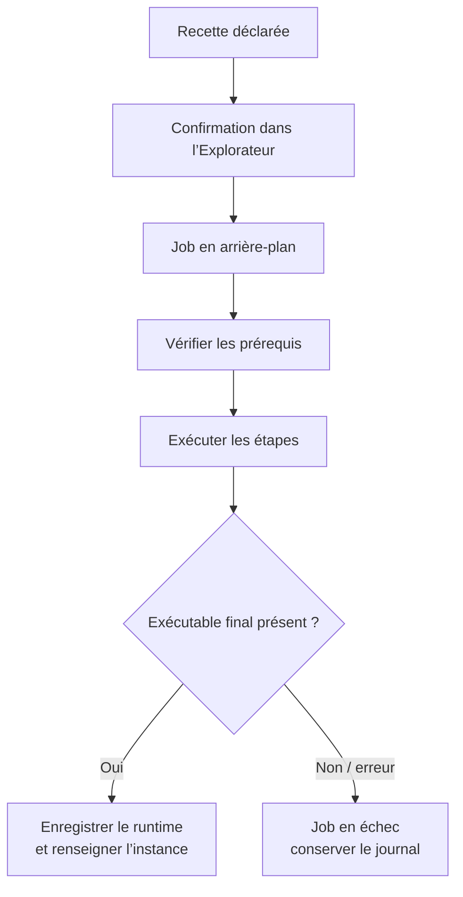

# 07 · Installer les runtimes et écrire une recette

[Manuel](README.md) · [Précédent : manifeste](MANIFEST_REFERENCE.md) · [Suivant : architecture](ARCHITECTURE.md)

## Ce que l’Explorateur découvre

L’Explorateur est construit à partir des mêmes dossiers que les formulaires d’intégration. Chaque `manifest.json` valide fournit une entrée. Il n’existe plus de second JSON de recette à maintenir ailleurs.

Une intégration sans `install.steps` peut créer des instances et utiliser un programme déjà installé. Elle ne propose pas d’installation de runtime.

Le filtre **Présents** regroupe les définitions personnelles, instances et runtimes détectés. Présent ne veut pas forcément dire prêt, ni contrôlé par PiHub.

## Détection d’un programme

L’ordre de recherche inclut les exécutables personnalisés des instances, les chemins d’installation enregistrés et les candidats du manifeste.

Un chemin existant n’est pas une vérification exhaustive de l’environnement. Un interpréteur Python peut être présent alors que son module serveur manque. La commande de diagnostic et les logs permettent d’identifier ce cas.

Pour les endpoints sans exécutable, un statut prêt peut indiquer une connexion existante.

## Installer depuis l’interface

1. Ouvrez la fiche de l’intégration.
2. Vérifiez la référence et les prérequis.
3. Dépliez les commandes d’installation si nécessaire.
4. Choisissez une autre révision uniquement si la recette l’autorise.
5. Lancez et confirmez l’installation.
6. Suivez le job et son journal dans l’Explorateur.
7. Configurez le modèle, le moteur (pour un agent) et les options avant de démarrer.

Le worker prépare le runtime ; il ne démarre pas automatiquement le serveur ou l’agent.



## Structure du bloc install

Exemple de structure à adapter à un véritable runtime :

```json
{
  "install": {
    "repository": "https://github.com/example/mon-runtime.git",
    "revision": "v1.2.3",
    "verification": "source-reviewed",
    "prerequisites": ["git", "python3"],
    "executable": "{package}/venv/bin/mon-runtime",
    "allow_revision": false,
    "steps": [
      {
        "label": "Installer depuis le script du dossier",
        "argv": ["python3", "{bundle}/install.py", "{package}", "{revision}"]
      }
    ]
  }
}
```

Cet extrait n’est pas un installateur fonctionnel à lui seul : le script `install.py` doit être fourni et réaliser l’installation annoncée.

| Clé | Rôle |
| --- | --- |
| `repository` | Source affichée et disponible dans les variables d’installation. |
| `revision` | Référence demandée par défaut. |
| `commit` | Commit de référence informatif, quand renseigné. |
| `verification` | `unverified`, `source-reviewed` ou `runtime-tested`. |
| `summary` | Résumé spécifique à l’Explorateur, sinon description de l’intégration. |
| `prerequisites` | Noms de programmes recherchés dans PATH. |
| `min_macos` | Version majeure minimale de macOS pour la recette. |
| `executable` | Chemin du programme attendu en fin d’installation. |
| `steps` | Étapes ordonnées. |
| `allow_revision` | Autorise une révision hors référence avec confirmation. |
| `env` | Variables du worker d’installation. |
| `runtime_env` | Valeurs destinées à l’environnement du runtime dans sa définition préparée. |

Le niveau `runtime-tested` signifie que des handlers ont été exercés avec un runtime. Il ne certifie pas une installation neuve sur chaque version de macOS. `source-reviewed` signale une recette étudiée à partir des sources ; `unverified` ne prétend pas une validation supplémentaire.

## Variables disponibles

| Variable | Valeur |
| --- | --- |
| `{package}` | Répertoire dédié à ce job dans `.pihub/packages/`. |
| `{bundle}` | Dossier qui fournit le manifeste et les scripts d’installation. |
| `{root}` | Racine du projet. |
| `{data}` | Dossier privé PiHub. |
| `{revision}` | Révision retenue pour ce job. |
| `{repository}` | Source déclarée dans la recette. |

Les variables disponibles ici diffèrent de celles d’une commande de runtime. Si vous devez enregistrer un chemin de package dans l’environnement du runtime, préparez-le explicitement avec `runtime_env` ou votre handler, puis vérifiez la commande après installation.

## Étape de commande

```json
{
  "label": "Vérifier l’outil de construction",
  "argv": ["python3", "--version"],
  "cwd": "{package}"
}
```

La commande est un tableau d’arguments, pas une chaîne shell. Le répertoire par défaut est `{package}`. L’entrée standard du worker est fermée : les scripts doivent fonctionner sans dialogue interactif.

Le worker hérite de l’environnement du manager et ajoute les variables déclarées dans `install.env`. Les prérequis ne sont pas automatiquement installés par cette seule déclaration.

## Étape d’archive

Une étape d’archive utilise `download` avec une URL HTTPS et `sha256` avec l’empreinte complète de 64 caractères hexadécimaux.

Le worker télécharge l’archive, vérifie l’empreinte, puis contrôle les chemins et liens avant extraction. Les étapes suivantes préparent l’exécutable final. Consultez la [recette Splash](../pihub-manager/integrations/splash/manifest.json) pour une utilisation réelle.

Les scripts déclarés sont du code exécuté localement. Le fait qu’une recette soit dans un JSON ne la rend pas inoffensive.

## Versions, commits et preuve d’installation

Trois valeurs ont des rôles différents :

| Valeur | Où ? | Signification |
| --- | --- | --- |
| `install.revision` | Manifeste | Référence utilisée par les étapes qui consultent cette variable. |
| `install.commit` | Manifeste, facultatif | Métadonnée de commit de référence. |
| `resolved_revision` | `.pihub/installations.json` | Référence effectivement enregistrée après l’installation. |

Le champ `commit` ne remplace pas à lui seul un checkout Git. Vos étapes doivent réellement récupérer la référence voulue. Le worker lit le commit d’un checkout situé dans `<package>/source/.git` lorsqu’il existe ; sinon il conserve la révision du job.

Pour les paquets npm et archives, le verrouillage dépend des étapes, versions et empreintes effectivement utilisées par la recette.

## Jobs, erreurs et réinstallation

| Élément | Emplacement |
| --- | --- |
| Job et état | `.pihub/install-jobs/<job-id>.json`. |
| Journal | `.pihub/install-jobs/<job-id>.log`. |
| Installation | `.pihub/packages/<job-id>/`. |
| Reçu de réussite | `.pihub/installations.json`. |

Un échec ou une annulation conserve les fichiers partiels pour le diagnostic. Une réussite n’est publiée qu’après vérification de l’exécutable attendu.

La réinstallation crée un autre package ; elle n’écrase pas le répertoire précédent. Les instances de l’intégration reçoivent le nouvel exécutable. Vérifiez aussi leurs environnements et leurs réglages spécifiques après une mise à jour.

La suppression d’un runtime géré est disponible lorsqu’aucune instance ne l’utilise selon les contrôles du manager. Les données et homes propres aux programmes peuvent nécessiter une gestion séparée.

[Suivant : architecture →](ARCHITECTURE.md)
