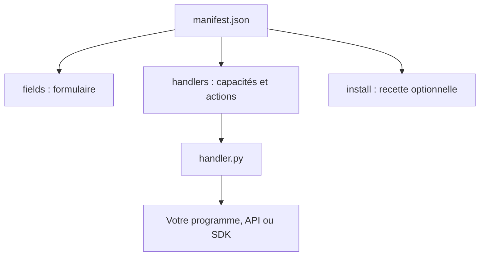

# 05 · Créer un moteur ou un agent personnalisé

[Manuel](README.md) · [Précédent : import/export](IMPORT_EXPORT.md) · [Suivant : référence du manifeste](MANIFEST_REFERENCE.md)

## Le format d’une intégration

Un dossier suffit :

```text
mon-integration/
├── manifest.json
├── handler.py
├── helper.py             # facultatif
└── ressources/           # facultatif
```

Le manifeste décrit l’identité, les paramètres, les commandes et les hooks disponibles. Son bloc `install` décrit l’installation optionnelle du runtime. Les fonctions Python réalisent les opérations propres au programme.

Les handlers peuvent utiliser les helpers fournis par PiHub ou implémenter leur propre protocole. Ils n’ont pas à hériter d’une classe particulière.



## Commencer par les exemples importables

Le dossier [examples/](examples/README.md) contient :

- [demo-provider](examples/demo-provider/) : un petit serveur HTTP d’écho piloté comme moteur ;
- [demo-agent](examples/demo-agent/) : un agent terminal qui utilise ce moteur ;
- [check_examples.py](examples/check_examples.py) : un contrôle de bout en bout, sans interface graphique.

Ces programmes démontrent le contrat PiHub. Leur réponse est un écho déterministe, pas la sortie d’un modèle IA.

Vous pouvez copier leurs dossiers, changer leurs identifiants et remplacer leur logique par celle de votre programme.

## Parcours A · Ajouter un moteur existant

### 1. Identifier le protocole et la commande

Déterminez :

- comment démarrer le serveur ;
- quelle URL indique qu’il est prêt ;
- comment lire la liste ou le nom des modèles ;
- quels paramètres peuvent varier selon l’instance ;
- quelles actions sont réellement prises en charge.

Les helpers HTTP communs conviennent aux serveurs dont le statut et la liste des modèles correspondent à ce contrat. Un autre protocole doit avoir son propre `status`.

### 2. Déclarer l’identité et les paramètres

Chaque champ possède `key`, `label`, `group`, `type` et `default`. Les valeurs d’instance restent des chaînes.

Extrait à intégrer dans un manifeste complet :

```json
{
  "id": "mon-serveur",
  "kind": "provider",
  "name": "Mon serveur",
  "icon": "server.rack",
  "color": "cyan",
  "description": "Mon moteur local",
  "model_format": "gguf",
  "health": "/health",
  "executables": ["mon-serveur"],
  "command": ["{executable}", "--model", "{model}", "--port", "{port}"],
  "fields": [
    {"key": "model", "label": "Modèle", "group": "Modèle", "type": "model", "default": ""},
    {"key": "host", "label": "Adresse", "group": "Réseau", "type": "text", "default": "127.0.0.1"},
    {"key": "port", "label": "Port", "group": "Réseau", "type": "number", "default": "18100", "min": 1024, "max": 65535},
    {"key": "executable", "label": "Exécutable", "group": "Avancé", "type": "file", "default": ""}
  ],
  "handlers": {
    "status": "handler.py:status",
    "start": "handler.py:start",
    "stop": "handler.py:stop",
    "restart": "handler.py:restart",
    "test": "handler.py:test",
    "preview": "handler.py:preview",
    "adopt": "handler.py:adopt",
    "logs": "handler.py:logs"
  }
}
```

Le programme `mon-serveur` est ici un emplacement à remplacer. Les flags doivent être ceux de votre vrai runtime. Aucun serveur de ce nom n’est installé par cet extrait.

### 3. Réutiliser les helpers quand le contrat correspond

Un `handler.py` minimal peut exposer :

```python
from pihub_manager.hub.integrations.providers.common import (
    http_status as status,
    start, stop, restart, test, preview, adopt,
)
from pihub_manager.hub.integrations.common import logs
```

Le helper HTTP utilise l’endpoint construit à partir de `base_url` ou de `host`/`port`. Sans `health`, il interroge `/v1/models`. Avec `health`, il teste cette route puis la liste des modèles.

Ne déclarez `adopt` que si votre statut identifie effectivement le processus. Le champ `process_signatures` aide la détection HTTP commune, mais ne transforme pas une API distante en processus local contrôlable.

### 4. Écrire un statut spécifique si nécessaire

```python
def status(ctx, request):
    # Interrogez ici votre API ou SDK avec un délai limité.
    response = ctx.runtime.http("http://127.0.0.1:18100/health")
    ready = bool(response.get("ready"))
    return {
        "ready": ready,
        "state": "ready" if ready else "loading",
        "model": response.get("model", ""),
    }
```

Dans une véritable intégration, construisez cette URL depuis les réglages de `ctx.item`. Cet exemple montre la forme du retour, pas une adresse à imposer à toutes les instances.

## Parcours B · Ajouter un agent terminal

### 1. Déclarer le routage

```json
{
  "routing": {
    "provider_field": "provider",
    "model_field": "model",
    "required": true
  }
}
```

Ajoutez aussi des champs `provider` de type `provider`, `model` de type `model` et, si utile, `project` de type `directory`.

Un modèle vide signifie que l’agent suit celui du moteur. Un modèle renseigné explicitement fixe son choix.

### 2. Construire sa vraie commande

```python
from pihub_manager.hub.configuration import endpoint
from pihub_manager.hub.integrations.agents.common import resolved, launch_base

def command(ctx, request):
    ctx, provider = resolved(ctx, request)
    argv, environment, cwd, values = launch_base(ctx)
    environment["MON_AGENT_BASE_URL"] = endpoint(provider)
    environment["MON_AGENT_MODEL"] = ctx.item["settings"]["model"]
    return argv, environment, cwd
```

Les noms de variables ci-dessus sont des exemples. Remplacez-les par ceux que votre agent lit réellement, ou ajoutez les flags appropriés à `argv`. Une déclaration de routage seule ne configure pas un SDK externe.

`resolved` vérifie le moteur et résout le modèle. `launch_base` applique la commande du manifeste et le dossier de travail. Le [demo-agent](examples/demo-agent/handler.py) montre une implémentation complète.

### 3. Déclarer les actions de session

Vous pouvez réutiliser les helpers communs :

```python
from pihub_manager.hub.integrations.agents.common import (
    start, stop, restart, status, preview, model_change,
)
terminal = start
```

Déclarez les fonctions correspondantes dans `handlers`. Le lancement terminal est supervisé par le backend PiHub ; il faut fournir un handler `command` valide.

Un agent qui lit son modèle au démarrage peut utiliser le `model_change` commun, qui propose une relance. Pour appliquer réellement un changement à chaud, écrivez votre propre action et votre politique : ne présentez pas une écriture de fichier comme une mise à jour de la session active.

## Ajouter une action personnalisée

Dans le manifeste :

```json
{
  "handlers": {"inspect-config": "handler.py:inspect_config"},
  "action_labels": {"inspect-config": "Inspecter ma configuration"}
}
```

Dans le handler :

```python
def inspect_config(ctx, request):
    model = ctx.item["settings"].get("model", "")
    return {"message": f"Modèle configuré : {model or 'hérité du provider'}"}
```

Cette action apparaît dans le menu d’actions de l’intégration. Les hooks internes sont réservés au manager.

## Proposer un guide de premier démarrage

Un handler `after_install` optionnel peut retourner :

```python
def after_install(ctx, request):
    return {
        "title": "Bienvenue dans mon agent",
        "message": "Vérifiez les réglages avant votre première session.",
        "steps": [
            "Sélectionner un moteur prêt.",
            "Choisir le projet.",
            "Ouvrir le terminal.",
        ],
        "action": "terminal",
        "action_label": "Ouvrir ma première session",
    }
```

Il faut déclarer `after_install` et l’action cible dans `handlers`.

**Déclenchement actuel :** ce hook fournit un guide lors de l’action `save` qui crée une nouvelle instance. Il n’est pas un hook général de fin de téléchargement du runtime. Une instance déjà précréée par un import ou par l’Explorateur ne repasse pas automatiquement dans ce chemin. Les actions nécessaires au fonctionnement doivent donc rester accessibles par leurs handlers.

## Ajouter une recette d’installation

Placez-la dans `install`, dans le même JSON. Utilisez un commit, tag, paquet ou archive précisément identifié et les prérequis nécessaires.

Le [chapitre runtimes](CATALOG.md) détaille les variables, le déroulement du worker et les références de versions. Une intégration sans recette reste utilisable avec un exécutable déjà installé.

## Tester et distribuer

1. Importez le dossier dans un workspace de test.
2. Vérifiez que l’intégration apparaît dans l’Explorateur.
3. Créez une instance et contrôlez ses champs.
4. Utilisez **Diagnostic → Commande** avant de démarrer.
5. Testez le statut, le lancement, les erreurs et l’arrêt.
6. Si votre agent est routé, changez le modèle du moteur et vérifiez la politique annoncée.
7. Exportez le dossier puis importez cet export dans un autre workspace.

N’ajoutez pas d’instances personnelles au code source. Pour contribuer au projet, proposez le dossier sous `pihub-manager/integrations/<id>/` avec sa documentation et sa vérification.

[Suivant : référence complète du manifeste →](MANIFEST_REFERENCE.md)
