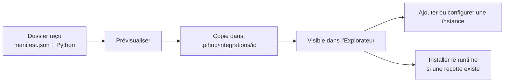

# 04 · Importer, exporter et sauvegarder

[Manuel](README.md) · [Précédent : modèles](MODELS.md) · [Suivant : créer une intégration](EXTENSIONS.md)

## Choisir ce que vous voulez partager

| Objet | Action | Contenu | Ne contient pas automatiquement… |
| --- | --- | --- | --- |
| Intégration | **Explorateur → fiche → Exporter le dossier** | Manifeste, handlers et ressources du dossier. | Vos instances, vos sessions, le runtime installé et les poids. |
| Workspace | **Réglages → Données → Exporter JSON** | Configuration des instances, réglages et références personnelles de modèles. | Les handlers, les exécutables, les poids ou les sessions des agents. |
| Projet source | `make package-source` | Manager, intégrations livrées, tests, documentation et outils de contribution. | `.pihub/`, runtimes locaux, caches, modèles et historiques privés. |
| Sauvegarde locale complète | Copie maîtrisée de vos données | Les dossiers que vous choisissez de conserver. | Une migration automatique des services externes ou des secrets système. |

L’export du workspace et l’export d’une intégration sont deux opérations différentes. Pour déplacer un setup personnalisé, il peut être nécessaire d’exporter les deux.

## Importer une intégration depuis l’interface

1. Récupérez et décompressez le dossier partagé.
2. Vérifiez qu’il contient `manifest.json` et les fichiers référencés.
3. Dans PiHub, ouvrez **Explorateur → Importer une intégration**.
4. Cliquez sur **Dossier…** puis sélectionnez ce dossier.
5. Vérifiez la définition proposée.
6. Choisissez **Importer seulement** ou **Importer et configurer**.



**Importer seulement** rend l’intégration disponible sans créer d’instance. **Importer et configurer** crée aussi une instance et ouvre ses réglages.

L’import du dossier n’exécute pas sa recette d’installation. Les handlers peuvent néanmoins être chargés lors de la découverte de capacités ou du suivi d’une instance ; leur code n’est pas exécuté dans un bac à sable. Le dossier doit donc provenir d’une source de confiance.

## Déposer le dossier manuellement

L’équivalent sur disque est :

```text
.pihub/
└── integrations/
    └── mon-provider/
        ├── manifest.json
        ├── handler.py
        └── ressources/
```

Les manifestes sont découverts au niveau `integrations/*/manifest.json`. Si l’archive reçue ajoute un dossier extérieur, ne laissez pas une profondeur supplémentaire :

```text
Correct : .pihub/integrations/mon-provider/manifest.json
Incorrect : .pihub/integrations/archive/mon-provider/manifest.json
```

Le nom du dossier doit rester explicite ; l’identité utilisée par PiHub vient du champ `id` du manifeste.

Un import de JSON seul reste disponible. Pour partager du code local et ses ressources, privilégiez le dossier complet. Sélectionner un fichier nommé `manifest.json` depuis l’interface permet aussi d’importer son dossier associé.

## Modifier une intégration livrée

Deux niveaux existent :

```text
pihub-manager/integrations/<id>/   définition livrée avec le projet
.pihub/integrations/<id>/          personnalisation locale prioritaire
```

Une copie personnelle portant le même `id` remplace la définition livrée dans ce workspace. Les modifications de **Configurer → Intégration → Personnaliser l’intégration…** enregistrent cette copie personnelle et conservent les propriétés inconnues du manifeste.

Pour créer votre variante indépendante, changez son `id`, son nom, et importez-la comme nouvelle intégration.

Les paramètres des instances ne sont pas dans ces manifestes : ils restent dans `.pihub/config.json`.

## Exporter un dossier

1. Ouvrez l’intégration dans l’Explorateur.
2. Cliquez sur **Exporter le dossier**.
3. Retrouvez le chemin annoncé sous `.pihub/exports/`.
4. Compressez ce dossier si vous souhaitez l’envoyer.

L’export conserve les chemins relatifs de handlers et retire la métadonnée de localisation `source` ajoutée par PiHub. Les caches Python sont exclus.

Il copie les ressources présentes dans le dossier. Gardez donc vos clés, fichiers de session et poids hors du bundle. Les chemins absolus vers vos exécutables ou fichiers personnels ne deviennent pas portables par magie.

Lorsqu’un export du même nom existe déjà, un nouveau dossier suffixé est créé.

## Importer ou exporter le workspace

Dans **Réglages → Données** :

- **Exporter JSON** produit un fichier `.pihub/exports/pihub-<date>.json`.
- **Importer…** permet de remplacer la configuration par un export valide.

L’import du workspace remplace sa configuration ; ce n’est pas une fusion de listes. Le backend refuse cette opération si des instances gérées sont encore actives. Arrêtez-les avant l’import.

Une sauvegarde de l’ancienne configuration est conservée dans `.pihub/backups/`.

Avant d’importer sur une autre machine :

1. importez les intégrations personnelles nécessaires ;
2. vérifiez les exécutables et ports ;
3. rendez les modèles accessibles ;
4. fournissez les variables d’environnement requises ;
5. adaptez les chemins propres à l’ancienne machine.

L’export remplace certaines références à la racine du projet par `{root}`. Les autres chemins absolus et dépendances externes doivent être revus.

## Restaurer et retrouver une ancienne définition

La restauration d’une intégration livrée remet sa définition source en service. La copie personnelle du dossier est archivée dans `.pihub/backups/`.

Les modifications de manifestes peuvent aussi produire des sauvegardes JSON et les remplacements de dossiers des sauvegardes complètes du bundle.

Consultez le contenu d’une sauvegarde avant de la restaurer : un JSON sauvegardé seul et un dossier contenant du code n’ont pas le même périmètre.

## Sauvegarder ses usages réels

Le dossier `.pihub/` ne contient pas nécessairement toutes les données d’un agent. Hermes utilise notamment son home et ses profils ; d’autres programmes possèdent leurs propres emplacements.

Pour conserver vos usages, identifiez :

- les réglages PiHub et les intégrations personnelles ;
- les homes et sessions des agents ;
- les variables et secrets à fournir séparément ;
- les poids ou références distantes ;
- les runtimes à réinstaller.

[Suivant : créer son intégration →](EXTENSIONS.md)
