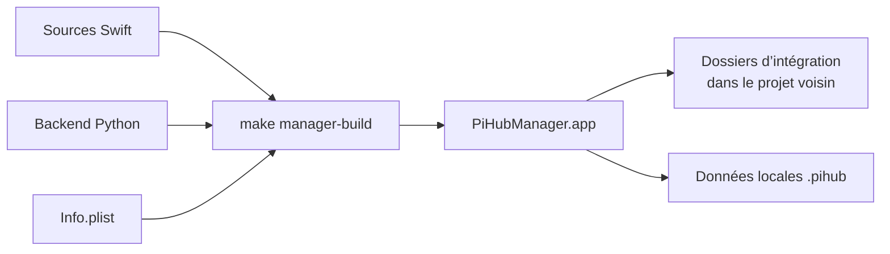

# 01 · Installer et mettre à jour PiHub

[Manuel](README.md) · [Accueil](../README.md) · [Suivant : utilisation](USAGE.md)

> Objectif de ce guide : faire apparaître l’icône PiHub dans votre barre des menus. Vous n’avez besoin d’installer ni modèle ni moteur avant cette étape.

## Prérequis

| Élément | Exigence du manager |
| --- | --- |
| Machine | Mac Apple Silicon, architecture `arm64`. |
| Système | macOS 13 ou supérieur. |
| Compilation | Outils Apple avec `swiftc`, installés via Xcode ou les Command Line Tools. |
| Backend | `/usr/bin/python3`, Python 3.9 ou supérieur. |
| Outils système | `make`, `zsh`, `rsync` et signature locale `codesign`. |
| Dépendances Python du manager | Aucune bibliothèque tierce. |

Ces prérequis concernent PiHub. Chaque runtime possède ses propres contraintes, affichées dans l’Explorateur : un moteur peut exiger une version plus récente de macOS ou un gestionnaire de paquets supplémentaire.

La recette Splash actuellement livrée cible macOS 26 ou supérieur. Elle ne modifie pas le minimum système de l’interface PiHub.

## Étape 1 — Récupérer les sources

Sur GitHub, utilisez **Code → Download ZIP** puis décompressez l’archive. Vous pouvez également cloner l’URL du dépôt avec Git.

La racine doit contenir au minimum :

```text
votre-dossier/
├── Makefile
└── pihub-manager/
    ├── build-swift.sh
    ├── swift/
    ├── src/
    ├── integrations/
    ├── templates/
    └── tests/
```

Les dossiers `docs/` et `.github/` ajoutent le manuel et les outils de contribution. Ils ne sont pas requis pour exécuter le manager.

## Étape 2 — Construire et ouvrir

Dans Terminal :

```sh
xcode-select --install
```

Une fenêtre macOS peut s’ouvrir. Terminez son installation, puis revenez dans Terminal. Ensuite, naviguez dans le dossier que vous avez décompressé :

```sh
cd /chemin/vers/PiHub
make check
make manager
```

Si `cd` répond « No such file or directory », remplacez `/chemin/vers/PiHub` par le vrai dossier. Astuce : tapez `cd `, faites glisser le dossier PiHub dans Terminal, puis appuyez sur Entrée.

La compilation crée `PiHubManager.app` à la racine. Le backend Python est copié dans l’application ; les définitions d’intégrations sont lues dans `pihub-manager/integrations/`.



`make manager` ouvre ensuite l’application en arrière-plan. Regardez tout à droite de votre barre des menus et cliquez sur l’icône PiHub. Vous voyez alors le panneau compact. Cliquez sur **Agrandir** pour voir Moteurs, Agents, Modèles et Explorer.

Pour ouvrir directement une fenêtre :

```sh
open PiHubManager.app --args --window
```

La signature produite par le script de build est locale. Le projet ne promet pas qu’une application copiée depuis un autre Mac soit notarialisée ou approuvée automatiquement par macOS.

## Les commandes utiles, sans jargon

| Commande | Effet |
| --- | --- |
| `make help` | Afficher les commandes du projet. |
| `make check` | Vérifier les prérequis de développement. |
| `make manager` | Construire puis ouvrir PiHub. |
| `make manager-build` | Construire sans ouvrir l’interface. |
| `make manager-open` | Ouvrir une application déjà construite. |
| `make manager-reload` | Reconstruire puis relancer l’application. |
| `make manager-status` | Afficher un diagnostic JSON du workspace. |
| `make test` | Exécuter les tests du backend. |
| `make package-source` | Préparer une archive des sources à partager. |

Les démarrages de moteurs, agents et modèles se font dans l’application. Le Makefile n’est pas un second gestionnaire de ces processus.

## Étape 3 — Premier lancement

Un projet neuf ne contient aucune instance ni référence de modèle personnelle. C’est normal.

Après avoir cliqué sur l’icône PiHub :

- ajouter une instance d’une intégration livrée ;
- réutiliser un exécutable déjà présent ;
- consulter puis exécuter une recette d’installation ;
- importer votre propre dossier d’intégration.

Installer PiHub ne télécharge pas tous les runtimes. Installer un runtime ne récupère pas automatiquement les poids de vos modèles.

Commencez par [le parcours guidé d’utilisation](USAGE.md) pour ajouter votre premier moteur et votre premier agent.

## Mettre à jour PiHub

1. Sauvegardez les intégrations personnelles ou le workspace si vous souhaitez conserver un point de restauration.
2. Mettez à jour les sources du dépôt, ou remplacez les fichiers source par ceux de la nouvelle version.
3. Conservez votre dossier `.pihub/` et vos environnements locaux.
4. Lancez `make test`, puis `make manager-reload`.

Une reconstruction ne met pas à jour automatiquement les runtimes tiers. Leur installation ou réinstallation passe par l’Explorateur.

Les copies personnelles d’intégrations ont priorité sur les versions livrées portant le même `id`. Après une mise à jour, vérifiez si vous souhaitez garder cette personnalisation ou restaurer la définition livrée.

## Déplacer le projet et choisir les données locales

Gardez l’application à côté du projet. Copier seulement `PiHubManager.app` ailleurs ne transporte pas automatiquement le dossier d’intégrations ni vos runtimes.

Deux variables sont reconnues :

| Variable | Rôle |
| --- | --- |
| `PIHUB_ROOT` | Racine qui contient `pihub-manager/` et les ressources du workspace. |
| `PIHUB_DATA` | Dossier de données privées ; par défaut `<racine>/.pihub`. |

Pour un workspace de développement séparé :

```sh
PIHUB_DATA="$PWD/.pihub-dev" \
  ./PiHubManager.app/Contents/MacOS/PiHubManager --window
```

Le backend lancé par le manager hérite de son environnement. Déplacer les données ne remplace pas les chemins absolus d’installations déjà enregistrées : vérifiez les exécutables et les références de fichiers après un déplacement.

## Désinstaller

Quitter PiHub ne signifie pas arrêter tous les runtimes lancés. Arrêtez ceux que vous souhaitez fermer depuis leurs instances.

L’application compilée et les sources peuvent être retirées séparément des données locales. `.pihub/` contient notamment des réglages, des installations, des logs et des sauvegardes. Les dossiers de modèles et les homes d’agents peuvent aussi contenir des données utiles ; consultez le [chapitre sauvegarde](IMPORT_EXPORT.md) avant de les déplacer ou de les supprimer.

[Suivant : utilisation →](USAGE.md)
