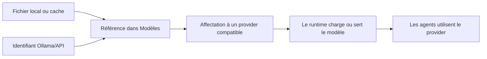

# 03 · Ajouter et utiliser des modèles

[Manuel](README.md) · [Précédent : utilisation](USAGE.md) · [Suivant : import/export](IMPORT_EXPORT.md)

## Une référence n’est pas le modèle lui-même

Le catalogue de modèles PiHub enregistre un nom, un identifiant, un format et éventuellement un chemin. Il ne transforme pas un modèle entre MLX, GGUF et un service distant.



Les poids doivent déjà être disponibles ou être obtenus par votre outil habituel. Installer le runtime depuis l’Explorateur ne télécharge pas automatiquement les poids.

## Les quatre formats du formulaire

| Format | Valeur à renseigner | Le provider doit savoir… |
| --- | --- | --- |
| `mlx` | Un identifiant de dépôt ou un chemin accepté par le moteur. | Lire ce modèle et ses fichiers MLX/safetensors. |
| `gguf` | Le chemin vers un fichier `.gguf`. | Charger ce fichier, par exemple avec llama.cpp. |
| `ollama` | Un identifiant présent ou géré dans Ollama. | Servir ce nom dans son daemon Ollama. |
| `api` | L’identifiant exact attendu par l’API. | Accepter cet identifiant côté serveur. |

Un dépôt contenant des fichiers safetensors n’est pas nécessairement un modèle compatible MLX. La compatibilité dépend de son architecture et du moteur.

## Ajouter une référence manuellement

1. Ouvrez **Modèles**.
2. Utilisez le bouton d’ajout pour ouvrir **Enregistrer un modèle**.
3. Choisissez un nom affiché.
4. Choisissez le format.
5. Renseignez l’identifiant ou le chemin.
6. Enregistrez.
7. Ouvrez un provider compatible et utilisez **Choisir dans le catalogue**, ou saisissez directement la référence dans son champ modèle.

Exemples de valeurs, à adapter à vos fichiers et services :

```text
Nom affiché : Mon modèle local
Format : GGUF
Identifiant : /Volumes/Modeles/mon-modele.Q4_K_M.gguf
```

```text
Nom affiché : Mon modèle distant
Format : API distant
Identifiant : identifiant-exact-du-service
```

Le formulaire GGUF enregistre aussi ce chemin dans le champ `path`. Pour les autres formats, la référence est principalement portée par `id`.

## Découvrir des modèles déjà présents

Dans **Réglages → Bibliothèque** :

1. Ajoutez les dossiers à scanner, un par ligne.
2. Enregistrez.
3. Retournez dans **Modèles** et utilisez l’action de rafraîchissement ou rescan disponible.

Le scanner recherche actuellement :

- les fichiers `.gguf` dans les sous-dossiers ;
- les caches Hugging Face au format `models--organisation--depot/snapshots/.../config.json` ;
- dans un dossier racine, un éventuel sous-dossier `huggingface/hub`.

Le scanner ne constitue pas une inspection universelle de tous les formats de modèles. Un dossier local hors de ces conventions peut nécessiter une référence manuelle. Certains dépôts auxiliaires DFlash/Splash sont volontairement exclus de la découverte de modèles principaux.

Les résultats sont mis en cache pendant environ une minute. Un rescan explicite invalide ce cache. Les références personnelles sont conservées séparément et ne dépendent pas d’un nouveau scan.

Exemple de liste de dossiers à adapter dans les réglages :

```text
/Volumes/Modeles
/chemin/vers/cache/huggingface/hub
```

Pour le cache Hugging Face, sélectionner directement le dossier `hub` contenant les répertoires `models--...` évite toute ambiguïté sur la structure attendue.

## Où se trouvent les données

| Donnée | Chemin par défaut |
| --- | --- |
| Références personnelles | `.pihub/config.json`, liste `models`. |
| Cache du scanner | `.pihub/models-cache.json`. |
| Dossiers à scanner | `config.settings.model_roots`, une ligne par chemin. |
| Dossier de départ du scanner | `<racine>/models`. |
| Poids | Leur emplacement réel sur votre machine ou côté service. |

L’export du workspace inclut les références enregistrées dans sa configuration. Il ne copie pas les poids et ne matérialise pas automatiquement toutes les découvertes du scanner.

## Affecter le modèle au bon programme

Le **provider** charge ou expose le modèle. L’**agent** choisit le provider et peut hériter de son modèle.

Deux situations différentes peuvent donc apparaître :

| Affichage | Signification |
| --- | --- |
| Configuré | Le réglage enregistré pour un prochain lancement ou chargement. |
| En cours | Le modèle effectivement annoncé par un runtime ou enregistré dans le contexte d’une session active. |

Un ancien processus ne doit pas être considéré comme mis à jour simplement parce que vous avez changé son formulaire.

Pour un serveur multi-modèles, comme un daemon pouvant exposer plusieurs modèles, l’installation et le chargement sont aussi des opérations différentes. Les actions disponibles dépendent du handler.

## Choisir le bon identifiant

Un nom d’affichage personnel n’est pas toujours un identifiant utilisable par une API. Pour une API distante, utilisez le nom exact attendu par ce serveur. Pour un moteur local, consultez les chemins ou identifiants qu’il accepte.

L’URL de base de l’API va dans le provider. Le champ modèle contient son identifiant ; ce n’est pas l’endroit où saisir une URL de conversation.

Si la requête échoue alors que l’API est prête, vérifiez :

1. l’identifiant du modèle ;
2. son format et son architecture ;
3. sa disponibilité réelle côté provider ;
4. les limites de mémoire et de contexte ;
5. la compatibilité des appels d’outils avec l’agent.

## Partager une configuration de modèles

Utilisez l’export du workspace si vous souhaitez partager les références avec les réglages des instances. Les chemins propres à votre machine devront être adaptés par le destinataire.

Un modèle seul n’est pas un dossier d’intégration : il n’a pas besoin d’un `handler.py`. Créez une intégration seulement pour ajouter un nouveau moteur ou un nouveau type d’agent.

[Suivant : import, export et sauvegardes →](IMPORT_EXPORT.md)
