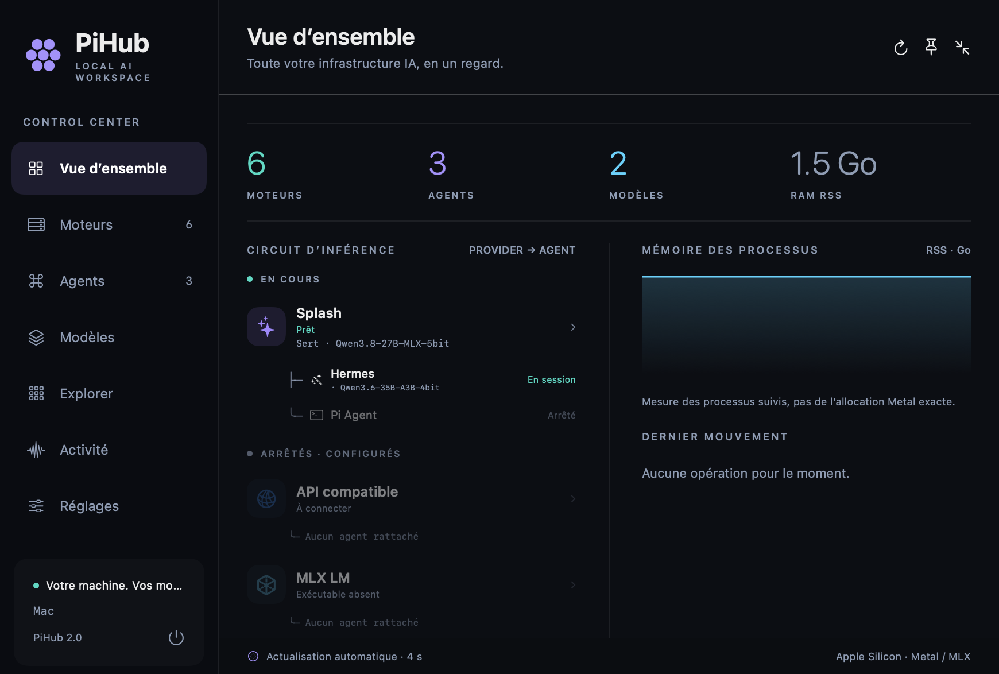
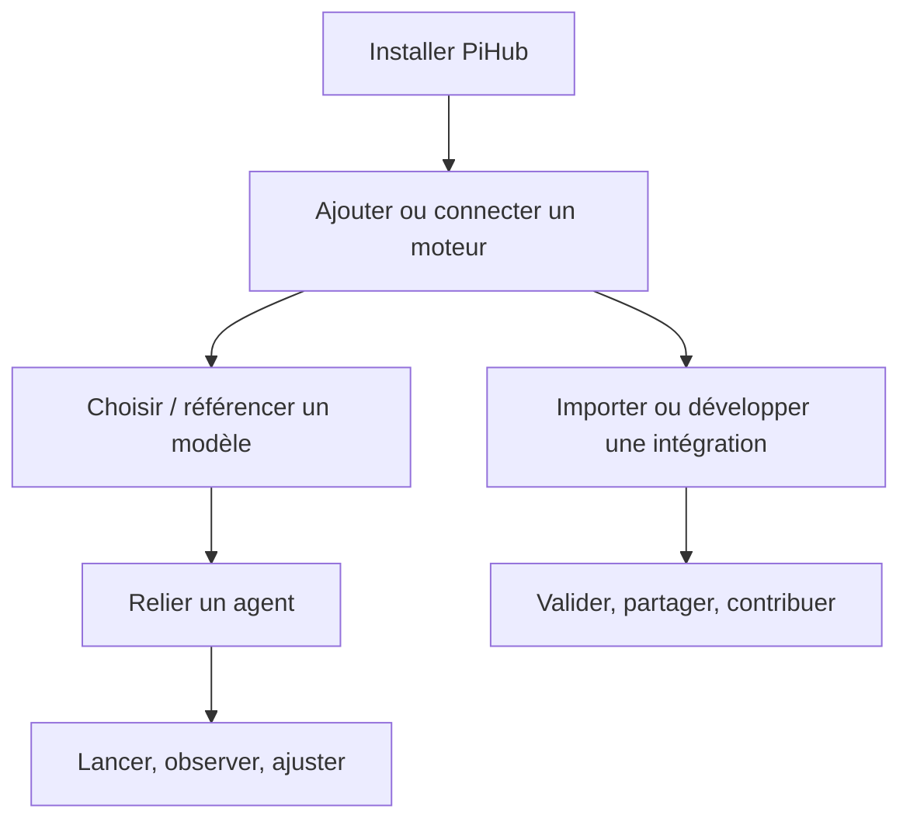

# Manuel PiHub

[← Accueil du projet](../README.md)

PiHub se prend en main dans l’application, pas en mémorisant une liste de commandes. Les guides ci-dessous indiquent ce que vous devez cliquer, ce que vous devez renseigner, puis ce que vous devez constater avant de passer à l’étape suivante.

> **Vocabulaire :** l’interface appelle **moteur** ce que les manifests appellent `provider`. Les mots `provider`, `kind: "provider"` et `provider_field` restent dans les extraits JSON/Python car ils font partie du format public.

## Choisissez votre parcours

| Je veux… | Commencez ici | Résultat attendu |
| --- | --- | --- |
| Ouvrir PiHub pour la première fois | [01 · Installation](INSTALLATION.md) | L’icône PiHub apparaît dans la barre des menus. |
| Utiliser un serveur que j’ai déjà | [API existante](USAGE.md#connecter-une-api-existante) | Le test API répond et l’agent voit le moteur. |
| Installer un moteur local | [Moteur local](USAGE.md#installer-un-moteur-local) | Son état devient **Prêt** et le résumé indique `Sert · …`. |
| Lancer Pi, Hermes ou Codex | [Ajouter un agent](USAGE.md#ajouter-et-ouvrir-un-agent) | Une session Terminal ou un dashboard s’ouvre avec le bon routage. |
| Ajouter des poids ou une référence de modèle | [03 · Modèles](MODELS.md) | Le format est visible et seul un moteur compatible est proposé. |
| Importer le dossier d’un autre utilisateur | [Importer un dossier](IMPORT_EXPORT.md#importer-une-intégration) | Le manifeste est validé avant la copie et avant toute exécution. |
| Ajouter mon propre programme | [05 · Extensions](EXTENSIONS.md) | Votre dossier apparaît dans Explorer et ses handlers deviennent disponibles. |
| Chercher une erreur de port ou de lancement | [10 · Dépannage](TROUBLESHOOTING.md) | Vous trouvez le journal et l’action sûre à effectuer. |

## Dans quel ordre lire ?

## Le manuel complet

| N° | Guide | À utiliser quand… |
| --- | --- | --- |
| 01 | [Installation](INSTALLATION.md) | Vous téléchargez, construisez ou mettez à jour PiHub. |
| 02 | [Utilisation](USAGE.md) | Vous configurez un moteur, un agent, un port ou une session. |
| 03 | [Modèles](MODELS.md) | Vous avez un GGUF, un dépôt MLX, une bibliothèque Ollama, une API ou un format personnel. |
| 04 | [Import / export](IMPORT_EXPORT.md) | Vous échangez un dossier, sauvegardez ou changez de machine. |
| 05 | [Extensions](EXTENSIONS.md) | Vous créez une intégration pour un moteur ou un agent. |
| 06 | [Référence du manifeste](MANIFEST_REFERENCE.md) | Vous avez besoin du contrat JSON ou de la signature d’un handler. |
| 07 | [Catalogue](CATALOG.md) | Vous écrivez ou auditez une recette d’installation/version. |
| 08 | [Architecture](ARCHITECTURE.md) | Vous devez comprendre les couches, les fichiers et les processus suivis. |
| 09 | [Développement](DEVELOPMENT.md) | Vous modifiez le dépôt, lancez les tests ou préparez une contribution. |
| 10 | [Dépannage](TROUBLESHOOTING.md) | Une installation, un modèle, un port ou une session ne se comporte pas comme prévu. |

## Exemple importable sans modèle

Avant d’installer un runtime tiers, vous pouvez suivre [l’atelier d’exemple](examples/README.md). Il contient un petit moteur HTTP d’écho et un agent terminal. Il vérifie le même parcours que les intégrations réelles — import, configuration, démarrage, routage, journal et arrêt — sans télécharger de poids.
