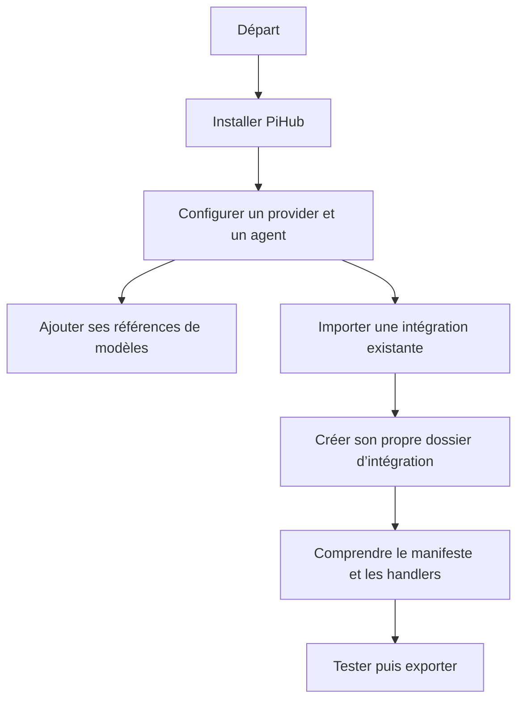

# Manuel PiHub

[Accueil du projet](../README.md)

Ce manuel suit deux parcours : prendre en main PiHub, puis étendre son fonctionnement avec vos propres intégrations. Les intitulés de boutons correspondent à l’interface actuelle ; les captures de configuration et les exemples utilisent des valeurs de démonstration.

## Lire dans l’ordre

| N° | Chapitre | Contenu |
| --- | --- | --- |
| 01 | [Installation](INSTALLATION.md) | Prérequis, construction, lancement, mise à jour et commandes Make. |
| 02 | [Utilisation](USAGE.md) | Premier provider, premier agent, instances, relances et diagnostics. |
| 03 | [Modèles](MODELS.md) | Références, fichiers GGUF, dépôts MLX, Ollama, API et découverte. |
| 04 | [Import et export](IMPORT_EXPORT.md) | Dossiers d’intégration, workspace, sauvegardes et partage. |
| 05 | [Créer une intégration](EXTENSIONS.md) | Parcours pas à pas pour un provider et un agent personnalisés. |
| 06 | [Référence du manifeste](MANIFEST_REFERENCE.md) | Champs JSON, formulaires, hooks, variables et contrats Python. |
| 07 | [Installation des runtimes](CATALOG.md) | Recettes, versions, commits, prérequis et suivi des jobs. |
| 08 | [Architecture](ARCHITECTURE.md) | Couches, flux, fichiers, suivi des processus et limites de mesure. |
| 09 | [Développement](DEVELOPMENT.md) | Structure du code, tests, exemples, CI et préparation de GitHub. |
| 10 | [Dépannage](TROUBLESHOOTING.md) | Symptômes courants et chemins de diagnostic. |

## Trouver directement le bon parcours

- **Je veux utiliser un serveur que j’ai déjà** : [API existante](USAGE.md#connecter-une-api-existante).
- **Je veux installer un moteur local** : [runtime local](USAGE.md#installer-un-provider-local), puis [modèles](MODELS.md).
- **Je veux importer le provider d’un autre utilisateur** : [import de dossier](IMPORT_EXPORT.md).
- **Je veux ajouter mon programme** : [modding](EXTENSIONS.md), puis [référence](MANIFEST_REFERENCE.md).
- **Je veux un exemple qui fonctionne sans modèle** : [atelier provider + agent](examples/README.md).
- **Je veux partager mon projet sur GitHub** : [publication](DEVELOPMENT.md).
- **Le modèle affiché ne correspond pas au modèle en cours** : [changement de modèle](USAGE.md#changer-le-modèle-dun-provider).
- **Je cherche le fichier qui contient un réglage** : [chemins et stockage](ARCHITECTURE.md#où-sont-les-fichiers).

## Schéma de lecture

## Sources et exemples

- [Intégrations livrées](../pihub-manager/integrations/) : exemples de programmes réels et recettes de référence.
- [Exemples pédagogiques](examples/README.md) : deux dossiers importables et un contrôle de bout en bout.
- [Schéma du manifeste](manifest.schema.json).
- [Schéma du bloc `install`](catalog.schema.json).
- [Guide de contribution](../CONTRIBUTING.md).

Les exemples pédagogiques utilisent un serveur d’écho. Les tableaux de recettes indiquent les prérequis ; aucun chapitre ne suppose que tous les moteurs ou modèles sont déjà installés.
