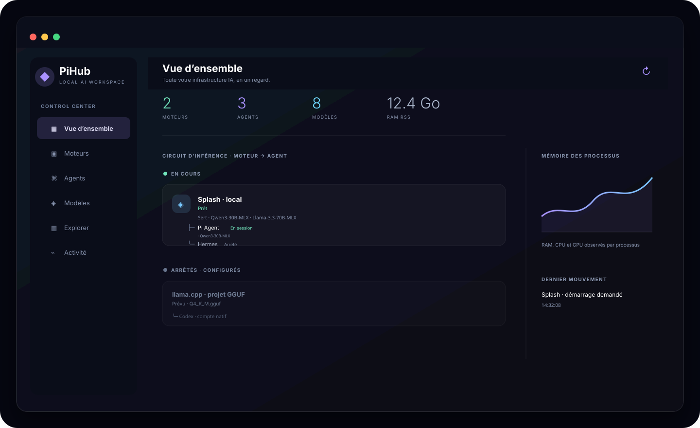

# 02 · Utiliser PiHub : le parcours clic par clic

[Manuel](README.md) · [← Installation](INSTALLATION.md) · [Modèles →](MODELS.md)



## Lire l’interface

| Zone | Cliquez ici pour… | Ce que vous devez voir |
| --- | --- | --- |
| **Vue d’ensemble** | Comprendre les liens entre vos instances. | Un arbre `moteur → agents`, les modèles `Sert · …`, et les éléments arrêtés en grisé. |
| **Moteurs** | Démarrer, arrêter, configurer un runtime local ou un endpoint. | Son état : **Prêt**, **Démarrage**, **Arrêté**, ou une indication de configuration. |
| **Agents** | Choisir un moteur, un projet, un modèle fixe et ouvrir une session. | Le moteur rattaché ou « Compte natif / Sans moteur ». |
| **Modèles** | Enregistrer une référence, un chemin local ou un format personnel. | Les moteurs compatibles proposés dans le menu d’affectation. |
| **Explorer** | Installer, réinstaller, importer ou exporter une intégration. | La version, les prérequis, le journal et la présence du runtime. |
| **Activité** | Lire les processus et ressources réellement observés. | CPU, RAM RSS, GPU lorsque disponible, PID et journal. |

Le panneau de barre des menus et la fenêtre complète utilisent les mêmes données. Cliquez sur **Agrandir** dans le panneau pour ouvrir la fenêtre ; cliquez sur l’icône de repli dans la fenêtre pour revenir au panneau compact.

> Dans les manifests et certains extraits techniques, « moteur » s’appelle `provider`. Ne renommez pas les clés JSON `provider`, `provider_field` ou `kind: "provider"`.

## Connecter une API existante

Utilisez ce parcours pour LM Studio, vLLM, un serveur maison ou toute API déjà démarrée.

1. Dans la barre latérale, cliquez sur **Explorer**.
2. Recherchez **API compatible**, puis ouvrez sa fiche.
3. Cliquez sur **Ajouter une instance**. Une ligne apparaît dans **Moteurs**.
4. Cliquez sur le bouton de réglages de cette ligne.
5. Dans **Connexion**, saisissez l’URL de base, par exemple `http://127.0.0.1:18000/v1`.
6. Dans **Modèle**, saisissez l’identifiant exigé par votre serveur.
7. Si une clé est nécessaire, saisissez son **nom de variable** — par exemple `MON_API_KEY`, jamais la valeur de la clé.
8. Cliquez sur **Enregistrer**, puis sur **Diagnostic → Tester API**.

Le test doit confirmer que l’API est disponible. S’il échoue, ouvrez le journal, vérifiez l’URL, le port et la variable, puis réessayez. Un moteur accessible ne garantit pas que tous les agents supportent son protocole : Codex requiert notamment l’API Responses et les appels d’outils.

### Fournir une clé sans la placer dans PiHub

Dans Terminal, définissez la variable puis lancez l’application depuis ce même Terminal :

```sh
export MON_API_KEY='votre-valeur-locale'
open PiHubManager.app --args --window
```

Une app ouverte depuis Finder n’hérite pas forcément des variables de votre shell. Quittez PiHub, ouvrez Terminal, exécutez ces deux lignes, puis refaites le test API.

## Installer un moteur local

1. Cliquez sur **Explorer**.
2. Ouvrez la fiche de Splash, llama.cpp, MLX LM ou Ollama.
3. Lisez **prérequis**, **version de référence** et **commandes**. N’installez pas si cette fiche ne correspond pas à votre format de modèle.
4. Cliquez sur **Installer**, lisez la confirmation, puis confirmez.
5. Restez sur la fiche : le job affiche sa progression. Cliquez sur **Journal** si une étape échoue.
6. Une fois terminé, cliquez sur l’icône de réglages de l’instance créée.
7. Dans **Modèle**, choisissez une référence déjà ajoutée dans PiHub, ou saisissez l’identifiant/chemin du modèle.
8. Vérifiez **Adresse**, **Port**, **Mémoire**, **Contexte** et les options propres au runtime, puis cliquez sur **Enregistrer**.
9. Dans **Moteurs**, cliquez sur **Démarrer**.

Attendez l’état **Prêt**. Dans le résumé, le moteur doit passer dans **En cours** et afficher `Sert · nom-du-modèle`. Si le port reste occupé après un arrêt, PiHub le signale explicitement : consultez **Activité** pour distinguer un sous-processus qui se ferme d’un processus externe.

### Runtime déjà installé ?

1. Dans **Explorer**, ouvrez le moteur concerné puis cliquez sur **Ajouter une instance**.
2. Ouvrez **Configurer → Avancé**.
3. Dans **Chemin de l’exécutable**, choisissez le fichier exécutable seul — pas une commande complète copiée depuis un terminal.
4. Enregistrez, configurez modèle/port, puis démarrez.

## Ajouter et ouvrir un agent

1. Cliquez sur **Agents**, puis sur **+**.
2. Sélectionnez Pi Agent, Hermes, Codex ou une intégration personnelle.
3. Cliquez sur le bouton de réglages de l’agent.
4. Dans **Routage**, choisissez le moteur prêt. Laissez le champ modèle vide si l’agent doit suivre le moteur ; remplissez-le seulement pour le fixer.
5. Choisissez le dossier de travail et les options propres à l’agent.
6. Cliquez sur **Enregistrer**.
7. Cliquez sur l’action de lancement : **Terminal**, **Dashboard**, ou l’action déclarée par cette intégration.

Les agents ont leurs propres handlers. PiHub ne suppose pas qu’ils se lancent tous de la même manière : Terminal, Web UI, profil, arguments ou configuration sont définis par l’intégration.

### Hermes : configurer le profil avant la première session

Quand Hermes affiche **Profil Hermes à configurer** :

1. Vérifiez que le moteur choisi dans **Routage** est **Prêt**.
2. Dans **Agents**, cliquez sur **Configurer le profil** ; ou ouvrez les réglages Hermes → **Diagnostic** → **Initialiser le gateway PiHub**.
3. PiHub crée le profil `pihub-<id-instance>`, y enregistre moteur/modèle/endpoint, puis initialise le gateway Hermes partagé.
4. Quand le message de succès s’affiche, ouvrez **Terminal** ou **Dashboard**.

Cette action ne configure pas vos plateformes Hermes (Telegram, Discord, etc.). Faites-le dans le profil Hermes si vous souhaitez les utiliser.

### Codex

Choisissez **Compte natif** pour conserver la configuration Codex habituelle. Pour le routage PiHub, choisissez un moteur qui supporte réellement Responses + outils ; une API limitée à Chat Completions ne suffit pas.

## Changer le modèle sans casser les agents

1. Ouvrez le moteur concerné dans **Moteurs**.
2. Choisissez un autre modèle puis cliquez sur **Enregistrer**.
3. PiHub affiche une proposition en haut de la fenêtre. Dépliez-la pour voir les agents rattachés, leurs modèles fixés et l’action disponible.
4. Cochez les agents souhaités, puis cliquez sur **Relancer le moteur et N agents**.
5. Confirmez.

PiHub relance le moteur via son handler, attend qu’il confirme le nouveau modèle, puis appelle le handler individuel de chaque agent. Si le moteur ne devient pas prêt, aucun agent n’est arrêté. Les agents arrêtés ou avec un modèle fixe ne sont pas modifiés sans votre décision.

## Avant de modifier : où regarder ?

| Vous voyez… | Faites ceci |
| --- | --- |
| **Exécutable absent** | Ouvrez **Configurer → Avancé** et choisissez l’exécutable, ou retournez dans Explorer pour l’installer. |
| **Profil Hermes à configurer** | Préparez le moteur, puis cliquez sur **Configurer le profil**. |
| **Démarrage** qui dure | Cliquez sur **Journal** dans les réglages et regardez l’action/commande réellement exécutée. |
| Port encore utilisé | Attendez le message de libération, puis consultez Activité : un processus externe peut retenir le port. |
| Action manquante | L’intégration n’a pas déclaré ce handler ; ouvrez sa définition ou utilisez son outil natif. |

[Continuer : modèles →](MODELS.md) · [Dépanner un incident →](TROUBLESHOOTING.md)
