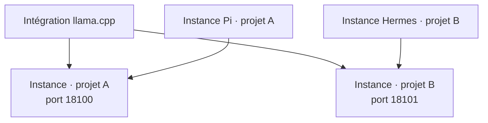
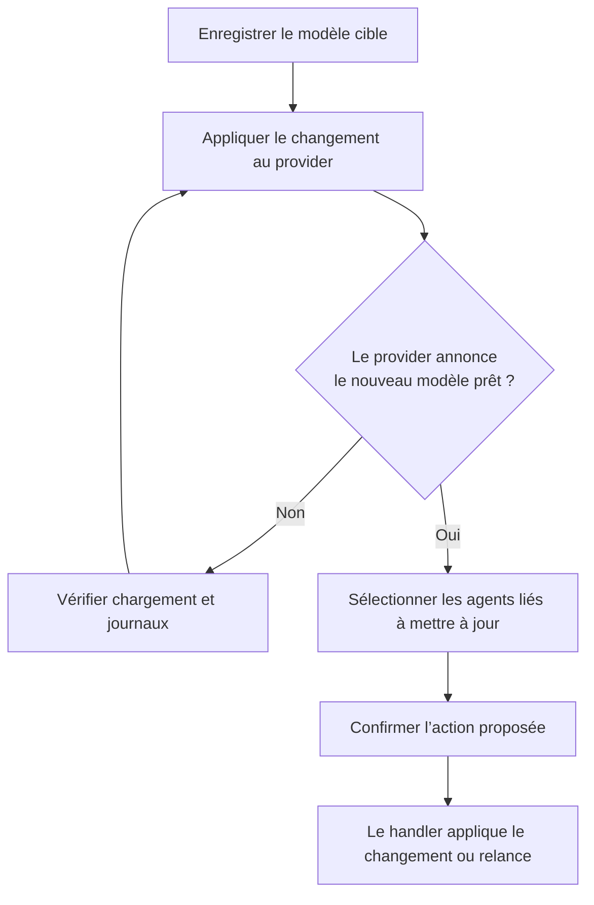

# 02 · Utiliser PiHub au quotidien

[Manuel](README.md) · [Précédent : installation](INSTALLATION.md) · [Suivant : modèles](MODELS.md)

## Les zones de l’interface

| Zone | À quoi elle sert |
| --- | --- |
| Vue d’ensemble | Voir les providers prêts, les sessions et les relations entre instances. |
| Providers | Configurer et piloter les moteurs ou endpoints. |
| Agents | Configurer le routage, le modèle, le projet et les sessions. |
| Modèles | Enregistrer et retrouver des références compatibles avec les providers. |
| Explorateur | Découvrir les intégrations, importer un dossier et installer un runtime. |
| Activité | Examiner les processus observés et l’historique de ressources. |
| Réglages | Gérer les dossiers de modèles, les intégrations et les données du workspace. |

Le panneau de barre des menus et la fenêtre partagent les mêmes données. Le bouton de détachement permet de travailler dans une fenêtre plus large.

## Connecter une API existante

1. **Explorateur → API compatible**.
2. Cliquez sur **Ajouter une instance**.
3. Ouvrez ses réglages et renseignez l’URL de base de l’API, incluant généralement `/v1`.
4. Choisissez un nom d’instance lisible et renseignez le modèle demandé par votre service.
5. Si une authentification est nécessaire, renseignez le nom de sa variable d’environnement.
6. Enregistrez, puis utilisez **Diagnostic → Tester API**.

Exemple d’URL pour un serveur déjà lancé : `http://127.0.0.1:18000/v1`.

La connexion au serveur ne vérifie pas toutes les fonctions de génération ou d’outils de chaque agent. L’intégration HTTP commune interroge notamment la liste des modèles. Validez ensuite une véritable demande depuis l’agent.

### Fournir une clé sans la mettre dans un manifeste

Dans le champ de clé, saisissez par exemple `MON_API_KEY`, et non la valeur secrète.

L’application doit recevoir cette variable. Pour une session lancée depuis Terminal :

```sh
export MON_API_KEY='votre-valeur-locale'
./PiHubManager.app/Contents/MacOS/PiHubManager --window
```

Cet exemple est à exécuter avec votre propre valeur. Évitez de publier votre historique de commandes ou de stocker une clé dans les exemples partagés. PiHub ne charge pas automatiquement un fichier `.env` arbitraire.

Une application ouverte depuis Finder n’hérite pas nécessairement des variables de votre shell. En cas de variable introuvable, quittez l’instance du manager en cours puis relancez-le dans l’environnement voulu.

## Installer un provider local

1. Dans **Explorateur**, ouvrez la fiche du moteur.
2. Lisez sa version de référence, ses prérequis et ses commandes.
3. Cliquez sur **Installer…** et confirmez.
4. Suivez le job d’installation ; son journal est disponible dans l’Explorateur.
5. Configurez l’instance avec son modèle, son adresse, son port et ses paramètres.
6. Démarrez le provider ; attendez le statut prêt avant d’ouvrir un agent.

Une recette crée un runtime dans `.pihub/packages/<job-id>/`. PiHub renseigne son exécutable dans les instances concernées.

Si le moteur est déjà installé, choisissez **Ajouter une instance**, puis sélectionnez son programme dans **Avancé → Chemin de l’exécutable**. Ce champ contient uniquement le programme, pas toute une commande shell.

## Créer plusieurs instances

Une intégration peut avoir plusieurs instances. Vous pouvez par exemple configurer deux serveurs llama.cpp sur des ports différents, ou deux agents Pi avec des dossiers de travail différents.



Le formulaire de l’intégration est partagé. Les valeurs de chaque instance sont indépendantes. Modifier les commandes ou handlers dans **Intégration → Personnaliser l’intégration…** modifie la définition de toutes ses instances.

Des ports distincts ne suffisent pas à garantir que deux modèles tiennent simultanément en mémoire. Les ressources nécessaires restent celles des runtimes.

## Ajouter et ouvrir un agent

1. Ajoutez une instance depuis **Agents → +** ou depuis l’Explorateur.
2. Dans **Routage**, sélectionnez le provider.
3. Laissez le modèle vide pour suivre celui du provider, ou renseignez un modèle fixe.
4. Choisissez le dossier de travail et les options de session.
5. Enregistrez, assurez-vous que le provider est prêt, puis ouvrez le terminal de l’agent.

Le niveau de réflexion n’est pas une garantie universelle. Le runtime, le modèle et l’agent doivent tous accepter les réglages concernés.

### Pi Agent

Dans **Session → Outils actifs**, sélectionnez les outils proposés : `read`, `bash`, `edit`, `write`, `grep`, `find`, `ls`.

Vous pouvez saisir un nom ou motif d’outil d’extension, puis valider avec Entrée. Ajouter un nom ne crée ni l’outil ni la connexion MCP : ils doivent être disponibles dans le runtime Pi utilisé.

La valeur est transmise à Pi via `--tools`. Les options MCP et hors ligne sont propres à la version de Pi référencée par l’intégration.

### Hermes

PiHub prépare un profil `pihub-<id-instance>` dans son home Hermes. Son modèle, son provider et son endpoint sont enregistrés dans ce profil.

Dans **Diagnostic**, le bouton **Initialiser le gateway PiHub** configure le profil, prépare le gateway hôte partagé et le redémarre pour prendre en charge le profil. Il devient une action de réapplication lorsque l’état est confirmé.

Cette initialisation concerne le gateway : elle n’est pas une condition générale pour toute session terminal Hermes. Elle ne configure pas vos comptes Telegram, Discord ou autres plateformes. Le gateway doit disposer des plateformes nécessaires à votre usage.

Le dashboard Web est une action distincte. Son premier démarrage peut nécessiter la construction du frontend.

### Codex

Le choix natif utilise sa configuration de compte habituelle. Un routage personnalisé nécessite un provider compatible avec son API Responses et ses appels d’outils. Un endpoint simplement compatible Chat Completions n’implique pas cette compatibilité.

## Changer le modèle d’un provider

Enregistrer un nouveau modèle change la configuration, pas forcément le modèle déjà chargé.



Les agents ayant un modèle fixe ne suivent pas cette proposition. Les agents arrêtés prennent le modèle au prochain lancement. Les sessions déjà sur le modèle cible ne nécessitent pas une relance supplémentaire.

Une relance ouvre une nouvelle session ; la conservation de l’état de conversation dépend de l’agent.

## Processus gérés, externes et exécutables personnalisés

- **Géré** : PiHub suit le processus qu’il a lancé ou explicitement pris en charge.
- **Externe** : un service est accessible, mais cela ne donne pas automatiquement à PiHub le contrôle de son processus.
- **Exécutable personnalisé** : le programme de cette instance diffère des candidats du manifeste.

Lorsque l’intégration sait identifier un processus externe, **Prendre en charge** peut l’associer au suivi PiHub. Une relance externe ou personnalisée peut être proposée avec confirmation ; elle n’est pas disponible pour n’importe quel processus arbitraire.

Si aucune relance sûre n’est identifiable, démarrez ou arrêtez le programme depuis son propre outil. Le manager ne tue pas tous les processus partageant un nom.

## Diagnostiquer avant de modifier

Dans l’éditeur d’instance, **Diagnostic** donne accès selon les handlers déclarés à la commande, aux journaux, au test API, aux actions de cycle de vie et aux informations d’exécutable.

Une action absente signifie souvent que l’intégration ne déclare pas son handler. Un exécutable présent n’est pas la preuve d’un service prêt, et un service prêt n’est pas la preuve de compatibilité de tous les agents.

Pour les incidents courants, utilisez le [chapitre dépannage](TROUBLESHOOTING.md).

[Suivant : modèles →](MODELS.md)
