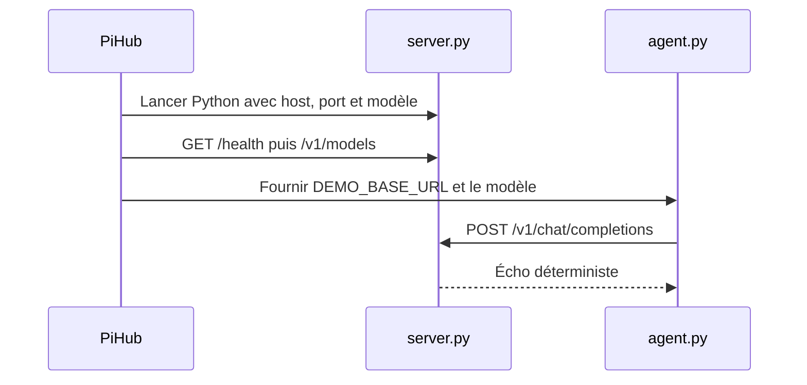

# Atelier · Un moteur et un agent importables

[Manuel](../README.md) · [Créer une intégration](../EXTENSIONS.md)

Cet atelier permet de tester le fonctionnement des dossiers d’intégration sans moteur IA ni poids de modèle.

Le moteur renvoie un écho de votre message. L’agent est un petit client terminal. Ce ne sont pas un modèle de langage, un agent autonome de développement ou une implémentation complète de toutes les API d’IA.

## Les dossiers

```text
docs/examples/
├── demo-provider/
│   ├── manifest.json
│   ├── handler.py
│   └── server.py
├── demo-agent/
│   ├── manifest.json
│   ├── handler.py
│   └── agent.py
└── check_examples.py
```

Chaque dossier `demo-*` peut être importé séparément. Ils ne sont pas installés automatiquement parmi les intégrations de production.

## Parcours dans l’application

### 1. Importer le moteur

1. Ouvrez **Explorateur → Importer une intégration → Dossier…**.
2. Sélectionnez `docs/examples/demo-provider/`.
3. Choisissez **Importer seulement**.
4. Ouvrez **Démo · provider HTTP** dans l’Explorateur (le nom technique de l’exemple est conservé).
5. Ajoutez une instance et configurez :
   - modèle : `demo-echo` ;
   - adresse : `127.0.0.1` ;
   - port : `18190`, ou un autre port libre ;
   - interpréteur personnalisé : vide pour utiliser `/usr/bin/python3`.
6. Enregistrez puis démarrez le moteur.
7. Vérifiez qu’il devient prêt.

PiHub utilise Python déjà disponible avec son environnement de développement. Aucune recette de téléchargement n’est nécessaire.

### 2. Importer l’agent

1. Importez `docs/examples/demo-agent/`.
2. Choisissez **Importer et configurer**, ou ajoutez une instance ensuite.
3. Dans **Routage**, sélectionnez votre moteur de démonstration.
4. Laissez le champ modèle vide pour hériter de `demo-echo`.
5. Enregistrez et ouvrez le terminal de cet agent.
6. Saisissez `Bonjour PiHub`.

Réponse attendue :

```text
Écho de démonstration : Bonjour PiHub
```

Saisissez `/quit` pour quitter le client. Arrêtez séparément le provider depuis son instance.

## Ce qui est démontré



Le provider réutilise les helpers HTTP et de processus. L’agent réutilise le cycle de vie des sessions et fournit une commande qui traduit le routage PiHub en une variable réellement lue par son client.

Le serveur ne gère pas le streaming, les appels d’outils ou l’authentification. Ne l’utilisez pas comme preuve de compatibilité avec tous les agents inclus.

## Contrôle automatique sans ouvrir l’interface

Depuis la racine du dépôt :

```sh
PYTHONPATH=pihub-manager/src /usr/bin/python3 docs/examples/check_examples.py
```

Le script :

1. crée un dossier temporaire pour l’état PiHub ;
2. importe les deux intégrations ;
3. choisit un port local libre ;
4. démarre le provider ;
5. résout le modèle et l’endpoint de l’agent ;
6. envoie une requête unique ;
7. arrête le provider et libère le workspace temporaire.

Les données de votre workspace habituel ne sont pas utilisées. Aucun modèle n’est téléchargé.

## Utiliser les exemples comme base

Copiez un dossier, puis :

- changez son `id` et son nom ;
- remplacez `server.py` ou `agent.py` par l’interface de votre vrai programme ;
- adaptez la commande et les paramètres ;
- déclarez uniquement les actions réellement prises en charge ;
- ajoutez un bloc `install` si le runtime doit être installé ;
- testez votre export dans un autre workspace.

Pour un moteur existant, il est souvent préférable d’appeler directement son exécutable plutôt que de réécrire un serveur Python.
